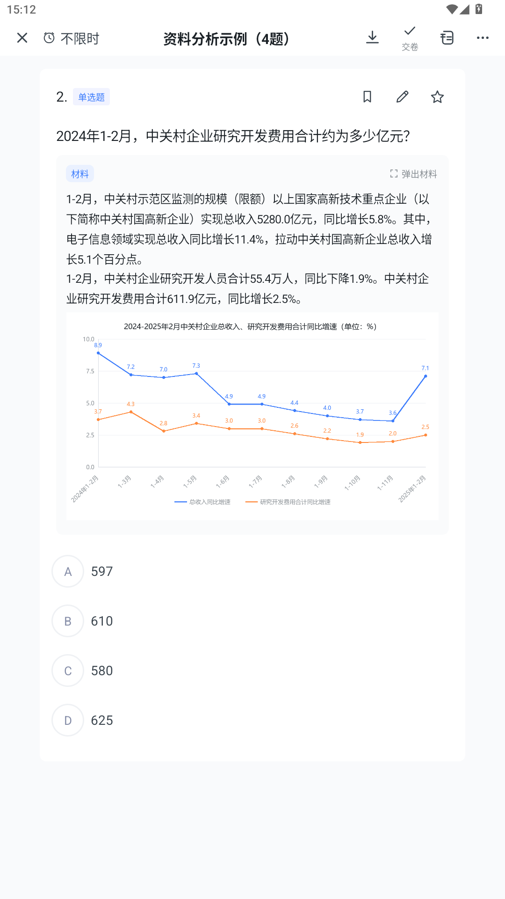
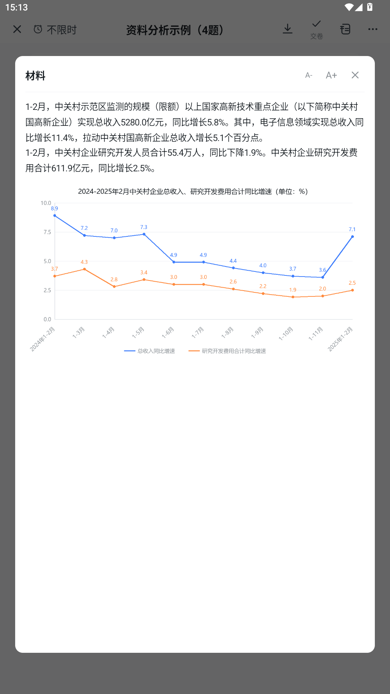
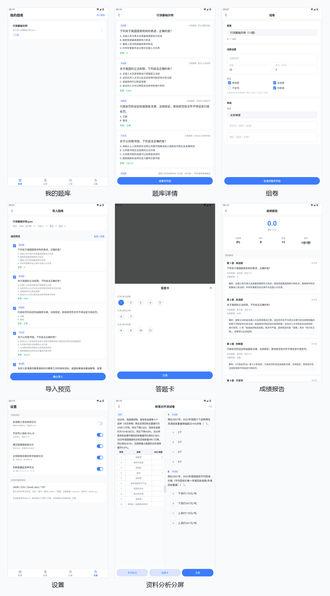

# 自定义题库刷题 App

一个可以**导入自己的题库**并刷题的 Android 应用。支持 `JSON` / `CSV` / `Excel(.xlsx)` / `TXT`
四种题库格式，自动探测格式与编码。**一个导入文件就是一份试卷**，导入后直接开练，限时答题、手写标注、查看成绩报告。

---

## 一、技术栈

| 项 | 说明 |
|---|---|
| 语言 | Kotlin |
| UI | 原生 View 体系 + ViewBinding（不引入 Compose，也不依赖第三方 UI 库） |
| 存储 | `SQLiteOpenHelper`，8 张表，无注解处理器 |
| 最低版本 | Android 7.0（API 24） |
| 编译 / 目标 | compileSdk 35 / targetSdk 35 |
| 构建 | AGP 8.7 + Gradle 8.11 + JDK 17 |
| 依赖 | 仅 AndroidX + Material；xlsx 解析为自研零依赖 OOXML 读取器（不引 Apache POI） |

---

## 二、功能

* **题库导入**：`JSON` / `CSV` / `Excel(.xlsx)` / `TXT` 四种格式，自动探测格式、自动识别编码（UTF-8 / GBK）、表头别名自动映射
* **答案可后补**：试卷常常只有题目没有答案。缺答案的题按「待补答案」正常导入、正常答题，做完之后再导一份答案文件（`题号,答案` 表格或题库答案版），按题号 / 题干自动匹配，**按已有作答直接重判**，不用重做一遍
* **导入校验**：逐行规范化 + 错误/警告清单（定位到行号），可勾选后再生成试卷
* **题库管理**：多题库、题目列表、知识点/地区/难度/来源标签
* **导入即建卷**：每个导入的文件直接生成一份试卷，题目按文件顺序整卷入卷；不再随机抽题组卷，同名试卷可覆盖导入
* **答题页**：顶部关闭 / 计时胶囊 / 铅笔 / 书签 / 更多图标区，左上题库名 + 右上进度（`6/11`），浅蓝题型标签，圆形 A/B/C/D 选项徽标（选中变蓝色实心圆），底部上一题 / 答题卡 / 标记 / 下一题操作条
* **单题 / 多题切换**：`更多 → 多题浏览 / 单题浏览`。多题为连续滚动列表，单题为一屏一题（左右滑动切题，长题干与材料题可在页内纵向滚动）；两套容器共享同一份题目卡渲染，切换时按「当前正在看的题」双向定位，答案、标记、收藏、字号、交卷后的解析全部同步；选择会持久化，下次进入沿用
* **夜间模式**：`更多 → 夜间`。覆盖答题页全套元素（题目卡、题型标签、选项徽标、材料表格、解析）、更多面板、手写工具条、答题卡弹层与系统状态栏／导航栏；偏好持久化，重进直接生效
* **横向滑动切题**：`ViewPager2` 左右滑动翻页；写画模式下遮盖层会拦掉翻页与选项点击，点「完成」退出后立刻恢复
* **题目遮盖层（可写）**：点题目卡右上角那支**笔**（或 `更多 → 手写标注·遮盖`），题目区盖上一张半透明薄纸——**手指或触控笔都能直接写**，带压感笔迹粗细。这一层会吞掉全部触摸：写字时不会误点选项、不会把题翻过去，掌托 / 第二根手指落下也不打断笔迹。想往下看长题干时，**贴着屏幕最右边那一条上下拖就能滚**（不落笔，笔迹跟着文字一起走；分屏页左边缘还有一条专门滚材料）。悬浮工具条提供撤销 / 清空 / **遮盖档位（关·浅·中·深）** / 标记 / 完成；点「完成」只是退出写画模式，**笔迹留在原处**，可以接着选答案。笔迹与遮盖档位都持久化，切题往返自动恢复
* **资料分析左右分屏**：「更多 → 开启左右分屏」进入分屏页——左侧材料（Markdown 表格渲染成可横向滚动的真表格），右侧该材料对应的全部题目；两栏都能用遮盖层做标注
* **材料配图与弹出材料**：图谱类材料（折线图 / 柱状图 / 饼图）**直接显示图片**——材料里写 `` 就行，支持本地路径、`file://`、`content://`、`asset://` 与 base64，按材料宽度铺满、点一下整屏看大图；没有配图的纯文本题库也可以用 `:::chart` 写数据让 App 自绘。材料卡右上角「弹出材料」：平板进就地分屏、手机进只读页（A- / A+ 调字号），都不打断答题状态
* **弹出材料左右分屏（平板端，一则材料多个题目）**：对齐参考应用——平板（最小屏宽 ≥ 600dp）上材料组点「弹出材料」，**当前答题页就地分成左右两栏**：左栏材料（表格 / 图表同套渲染，可「收起材料」还原），右栏这组题目一屏一题、左右滑动切题、照常作答、实时同步主容器，且右栏题卡**不再重复渲染材料**（左栏已有整栏）；左栏头部显示组内进度（N/M）。**手机端**保持常规：点「弹出材料」进材料只读页，题目卡里材料原样保留
* **标记与笔记**：书签图标标记本题，「更多 → 编辑笔记」写思路，笔记按题保存
* **计时与交卷**：倒计时、剩 5 分钟提醒、超时自动交卷、交卷二次确认（"你还有 N 道题目未作答，确定交卷吗？"）
* **练习模式（即时判分）**：`更多 → 练习模式·即时判分`。开启后作答立刻判色——正确项绿实心、选错项红实心，解析内联展开，不必等整卷交卷（对齐参考应用「练习」作答口径）；选项按内容长度自适应排布，短选项（≥4 个且文本短）自动两列
* **中途退出续做**：退出自动保存作答 / 标记 / 已用时，重进弹「继续答题 / 重新开始」，倒计时从上次退出的地方接续；交卷后进度自动清除
* **收藏持久化**：星星收藏落库，跨会话保留，重进 / 重装升级都不丢
* **成绩报告**：得分 / 正确率 / 用时 / 逐题解析，四态标色（全对 / 部分得分 / 错误 / 未答）；多模块卷自动汇总**分模块正确率**（按科目 / 知识点聚合），定位薄弱模块
* **错题重练**：成绩报告右上角一键把本次答错 / 部分得分的题按原顺序生成新卷，直接开练
* **判题规则可配**：多选少选是否给分、不定项少选给 50%、填空漏填给部分分、主观题关键词命中给部分分、判断题兼容"对/错/√/×/T/F"

### 当前版本范围：仅选择题

答题流程当前只完整支持选择题（单选 / 多选 / 不定项 / 判断）。

* 答题页不渲染填空输入框与主观题作答区
* 题库中若存在填空 / 主观题，导入时会被拒绝或降级为单选题（带选项时）
* 数据模型层仍保留 `FILL` / `SUBJECTIVE` 题型定义与对应判题规则（`Judge.kt`），以便后续放开

### 判题口径（`engine/Judge.kt`）

| 题型 | 规则 |
|---|---|
| 单选 | 答案键完全一致才得分 |
| 多选 | 默认**全对才得分**（多选/少选/错选均不得分），可在设置里开启"少选给部分分" |
| 不定项 | 全对满分；少选给 50%（可配）；错选 0 分 |
| 判断 | 归一化 `T/F/对/错/√/×/Y/N` 后比对 |
| 填空 | 多空用 `\|` 分隔，逐空比对（忽略空白/标点/全角），漏空可给部分分 |
| 主观 | 按 `得分点` 关键词命中率给分，命中全部为满分 |
| 无标准答案 | 标为「待补答案」，不判分；不计满分、不计正确率分母、不计答错 |

---

## 三、题库格式说明

所有格式都支持下列**字段别名**（大小写、空格、下划线、全半角都会自动归一）：

| 规范字段 | 可用表头别名 |
|---|---|
| 题型 | 题型 / 类型 / 题目类型 / type / questionType / category |
| 题号 | 题号 / 题序 / 序号 / 顺序 / 编号 / no / number / index / seq（补答案时用来对位） |
| 题干 | 题干 / 题目 / 试题 / 问题 / stem / question / title / content |
| 材料 | 材料 / 背景 / 资料 / material / passage / context |
| 选项 | 选项A…选项H / A / option_a / optionA（也支持把整列选项放一个单元格） |
| 答案 | 答案 / 正确答案 / 标准答案 / answer / correctAnswer / key |
| 解析 | 解析 / 答案解析 / 说明 / analysis / explanation / remark |
| 知识点 | 知识点 / 考点 / 标签 / knowledge / point / tag |
| 难度 | 难度 / 难度等级 / difficulty / level（支持 1/2/3 或 易/中/难） |
| 地区 | 地区 / 省份 / 城市 / region / area / province |
| 科目 | 科目 / 学科 / 分类 / 模块 / subject / category / section |
| 来源 | 来源 / 出处 / 试卷来源 / source / origin |
| 年份 | 年份 / 年度 / year |
| 分值 | 分值 / 分 / 分数 / score / points |
| 得分点 | 得分点 / 关键词 / 采分点 / keywords / keyPoints（主观题按此判分） |

### 题型写法

`单选` `多选` `不定项` `判断` `填空` `主观` —— 也接受 `single` / `multi` / `uncertain` / `judge` / `fill` / `subjective` 与 `1`~`6`。

### 答案写法

* 单选：`A`
* 多选 / 不定项：`A,C`（CSV 中含逗号时**必须用双引号包裹**：`"A,B,D"`）
* 判断：`正确` / `错误` / `T` / `F` / `A` / `B`
* 填空：多空用 `|` 分隔，如 `人民代表大会制度|全国人民代表大会`
* 主观：整段参考答案 + 单独的「得分点」列

> **答案可以不写。** 整列缺失、或某几行为空时，这些题以「待补答案」入库：
> 正常答题、正常交卷，只是暂不判分，见 [答案后补](#答案后补)。

### 材料里的表格、图片与图表

「材料」是一个纯文本单元格，支持 Markdown 表格、**图片（图谱类材料推荐）**，以及可选的 `:::chart` 数据图表。

**图谱类材料直接用图片。** 材料里单独一行写图片地址即可，会渲染成配图，点一下整屏看大图：

```markdown
1-2月，中关村国高新企业实现总收入5280.0亿元，同比增长5.8%。其中，电子信息领域同比增长11.4%……

| 指标 | 2024年1-2月 | 2025年1-2月 |
| --- | --- | --- |
| 总收入（亿元） | 4990.5 | 5280.0 |


```

| 图片来源 | 写法 | 说明 |
|---|---|---|
| 本地文件 | `/sdcard/Download/题库/图1.png` 或 `file:///...` | 最稳。建议把图片和题库放同一个文件夹，按绝对路径引用 |
| 相册 / 文件选择器 | `content://media/...` | 只在本次运行内有效，重启后授权可能失效 |
| 应用内置图 | `asset://samples/xxx.png` | 仅用于内置示例题库 |
| 自包含 | `data:image/png;base64,...` | 图片直接写进 JSON / 单元格，题库不依赖外部文件（体积会变大） |
| 题库包内 | `images/chart-01.png`（相对路径） | **推荐**：题库和图片打成一个 zip，导入时自动解压并换成绝对路径，见下一节 |

也认 `[图片](路径)` 与「整行只有一个图片路径」两种写法。图片按材料宽度铺满、最高 420dp（长截图不会一屏糊满），
加载失败会明确写出是哪张图没取到。只做本地解码，不申请网络权限——刷题时不会因为图挂了看不到材料。





**没有配图时**，也可以用 `:::chart` 让 App 按数据自绘折线 / 柱状图（纯文本题库、Excel 不方便带附件时用）：

```markdown
:::chart
title: 2024-2025年2月中关村企业总收入、研究开发费用合计同比增速（单位：%）
type: line
x: 2024年1-2月, 1-3月, 1-4月
series: 总收入同比增速=8.9, 7.2, 7.0
series: 研究开发费用合计同比增速=3.7, 4.3, 2.8
:::
```

| 键 | 说明 |
|---|---|
| `title` | 图表标题（也认 `标题`） |
| `type` | `line` 折线（默认）/ `bar` 柱状（也认 `柱状`） |
| `x` | X 轴标签，逗号 / 顿号分隔 |
| `series` | `名称=值1,值2,…`，可写多行；缺值写 `-`，折线在这一点断开 |
| `min` / `max` | 手动指定 Y 轴范围；不写就按数据自动取整刻度 |
| `showValues` | 是否在数据点标数值，默认 `true` |

图表块也认 ` ```chart ` 围栏。格式不对不会静默吞掉，材料里会显示一条「图表数据格式有误」的提示。
自绘的好处是日夜两套配色、字号随卡片缩放，题库始终是纯文本。

### 题库包（zip）：标准目录结构，图片随包走

材料图片写绝对路径，换台设备就丢图。**题库包**把主数据和素材打成一个 zip，导入时自动解压到应用私有目录：

```
资料分析题库包.zip
└── 资料分析题库包/          ← 外层目录可有可无，导入时会剥掉
    ├── qbank.json          ← 必需：题库主数据
    ├── images/             ← 可选：材料配图
    │   ├── chart-01.png
    │   └── chart-02.png
    └── README.txt          ← 可选：说明文件，不参与导入
```

`qbank.json` 就是普通 JSON 题库，材料里的图写**包内相对路径**：

```json
{
  "bank": "资料分析题库包",
  "description": "材料配图随包分发",
  "questions": [
    {
      "type": "单选",
      "stem": "2025年1-2月，总收入约比上年同期增加多少亿元？",
      "options": { "A": "289", "B": "306", "C": "258", "D": "320" },
      "answer": "A",
      "material": "1-2月，……同比增长5.8%。\n\n"
    }
  ]
}
```

| 规则 | 说明 |
|---|---|
| 主数据文件名 | `qbank.json` → `questions.json` → `bank.json`；都没有时取包内唯一的 json / csv / xlsx |
| 外层目录 | 压缩软件默认「再包一层文件夹」不影响，单层自动剥掉 |
| 图片引用 | `images/x.png` 或 `./images/x.png`，导入时替换成解压后的绝对路径再入库 |
| 内嵌格式 | 主数据可以是 JSON / CSV / Excel，图片统一放 `images/` |
| 解压位置 | `filesDir/qbank_pkg/<包名>-<CRC32>/`，同一个包重导入复用同一目录；包内容变了换新目录，不会新旧图混用 |
| 路径安全 | `..`、绝对路径、`__MACOSX/` 这类条目直接跳过，绝不会写到包外 |
| 打包 | 整个文件夹压成 zip 即可；文件名建议 UTF-8 或纯英文，个别压缩工具会写 GBK 文件名导致乱码 |

题库包自带的 `bank` 名会作为试卷名默认值；同名再导入走「覆盖导入」。图片只做本地解码，不申请网络权限。


仓库自带示例：`sample/资料分析题库包/`（目录形态）与 `sample/资料分析题库包.zip`（打包结果），
由 `python sample/make_package.py` 生成；导入页「载入示例题库 → 资料分析题库包（zip）」可直接体验。

---

## 三点五、答案后补

「题目先到、答案后到」是最常见的真实情况。流程分两段：

### 1. 导入没答案的试卷

答案列缺失或为空都不再报错跳过，只给一条警告：

```
第 12 行 · 缺少答案，已按「待补答案」导入
```

导入预览的统计里会多一项 `缺答案：N`，题目列表上也会标出「待补答案」。

### 2. 做完之后导入答案

三个入口，任选其一：

| 入口 | 位置 |
|---|---|
| 答题页 | `更多 → 导入答案（N 题待补）` |
| 交卷时 | 点「交卷」，若本卷还有待补答案，弹窗提供「导入答案 / 直接交卷」 |
| 成绩报告 | 右上角「导入答案」，写完立即按这条记录重判 |
| 试卷列表 | 长按试卷 →「导入答案」 |

答案文件支持 `JSON` / `CSV` / `Excel` / `TXT`：

```
# 最省事的写法：题号 + 答案（TXT 一行一题，一行多条也认）
1.B
2.A,C
3.对
```

```csv
题号,答案,解析
1,B,乙项符合题意
2,"A,B,D",
3,正确,行政复议不收费
```

也可以直接拿**原题库的答案版**（带题干），匹配会更稳。

### 匹配规则

1. **题干**优先（归一化后全等）——答案文件题序被打乱也能对上；
2. 其次按**题号**（1 起，对应卷内顺序）；
3. 两者都没有（纯答案列表）时按**顺序**填给尚未匹配的题。

写入前会弹窗告知「匹配 N/M 题、哪几题原有答案会被覆盖、哪些没匹配上」，确认后才落库。
补完答案，待补答案的题会被清零，成绩报告按记录里保存的**原作答**重新判分。

> 待补答案的题不参与判分：不计入满分、不计入正确率分母、也不算「答错」。

### 示例文件

`sample/` 目录下提供同一份题库的四种格式（各 **11 题**，覆盖选择题的全部四种题型 + 2 道资料分析带表材料题）：

* `行测基础示例.json` ← **唯一数据源**
* `行测基础示例.csv`
* `行测基础示例.xlsx`
* `行测基础示例.txt`

四种格式由 `sample/make_xlsx.js` 从 JSON 单一数据源生成，改题只需改 JSON 后重跑：

```bash
node sample/make_xlsx.js
```


`sample/资料分析题库包/` + `sample/资料分析题库包.zip`：题库包标准结构的完整示例（qbank.json + images/），4 题共用一张折线图，图片走相对路径；生成脚本 `sample/make_package.py`。

`sample/资料分析示例.json`（同步在 `app/src/main/assets/samples/` 里，「载入示例」可直接体验）：4 道资料分析题共用一份带图表配图的材料，用来演示图片材料、「弹出材料」与 `:::chart` 两种做法。配图 `资料分析折线图.png` 是本仓库自绘的示意素材。

---

## 四、构建与运行

需要准备：

| 组件 | 版本 |
|---|---|
| JDK | 17（AGP 8.7 / Kotlin 编译器不支持 JDK 21+，会报 `IllegalArgumentException`） |
| Android SDK | platform 35 + build-tools 35.0.0 |
| Gradle | 用仓库自带 wrapper（`./gradlew`） |

```bash
# 按自己的环境设置
export JAVA_HOME=/path/to/jdk-17
export ANDROID_HOME=/path/to/android-sdk

./gradlew assembleDebug        # 产物：app/build/outputs/apk/debug/app-debug.apk
adb install -r app/build/outputs/apk/debug/app-debug.apk
```

> `local.properties` 里的 `sdk.dir` 由 Android Studio 自动生成，不入库。
> 如果你的机器同时装了多个 JDK，可在 `gradle.properties` 中用 `org.gradle.java.home` 固定到 17。

### 自动化测试

```bash
./gradlew connectedDebugAndroidTest
```

`app/src/androidTest/.../ImportInstrumentedTest.kt` 覆盖的用例：

| 用例 | 覆盖点 |
|---|---|
| `json_imports_all_questions_and_types` | JSON 解析 11 题、选择题四种题型齐全、选项/答案/知识点正确 |
| `csv_imports_all_questions` | CSV 表头别名映射、`"A,B,D"` 带引号多选答案 |
| `xlsx_imports_all_questions` | xlsx 解析、sharedStrings 读取 |
| `txt_imports_all_questions` | TXT 段落分题、`答案:`/`解析:`/`知识点:` 前缀识别 |
| `format_detection_works` | 四种格式的自动探测 |
| `judging_rules_work` | 单选/多选（全对、少选、错选）/判断（多种写法） |
| `material_with_table_is_parsed` | 带表格的材料被完整解析，不污染题干 |
| `txt_material_is_kept_whole` | TXT 多行材料块完整保留 |
| `all_imported_questions_are_answerable` | 所有导入题目都是选择题（当前版本范围） |

`app/src/androidTest/.../AnswerBackfillTest.kt` 覆盖「没答案 → 补答案 → 重判」：

| 用例 | 覆盖点 |
|---|---|
| `paper_without_answers_is_importable` | 整卷缺答案仍能导入，只报警告不报错 |
| `answer_txt_matches_by_number` | TXT「1.A」题号匹配，多选/判断答案归一化 |
| `answer_csv_matches_by_stem_when_order_differs` | 答案表题序与卷内相反时按题干匹配 |
| `backfill_then_rejudge_uses_existing_answers` | 补答案后重判记录：待补清零、得分/满分/答对数正确 |

---

## 五、代码结构

```
app/src/main/java/com/lytree/qbank/
├── data/
│   ├── model/Question.kt        # 题目 / 选项 / 题型 / 记录 模型
│   ├── importer/
│   │   ├── Normalizer.kt        # 表头别名表 + 逐行规范化与校验
│   │   ├── Importer.kt          # 格式探测 + 导入调度
│   │   ├── JsonImporter.kt
│   │   ├── CsvImporter.kt       # 分隔符/编码/引号全兼容
│   │   ├── XlsxReader.kt        # 零依赖 OOXML 读取器（不引 Apache POI）
│   │   ├── TxtImporter.kt       # 按题号切块 + 多行材料累积
│   │   └── AnswerSheet.kt       # 答案后补：答案文件解析 + 题干/题号/顺序三级匹配
│   └── db/QBankDb.kt            # SQLiteOpenHelper，8 张表，无注解处理器
├── engine/Judge.kt              # 判题计分 + 汇总
└── ui/
    ├── MainActivity.kt          # 4 个 Tab
    ├── ImportActivity.kt        # 选文件 → 解析 → 校验预览 → 勾选生成试卷（支持外部 Intent 传入文件）
    ├── AnswerImportUi.kt        # 「导入答案」公共流程：解析 → 匹配 → 确认 → 写库
    ├── BankDetailActivity.kt    # 题库题目清单 + 开始答题
    ├── ExamActivity.kt          # 答题（多题连续滚动 / 单题 ViewPager2 双模式 + 手写标注）
    ├── QuestionCardBinder.kt    # 题目卡渲染（两种浏览模式共用）
    ├── QuestionPagerAdapter.kt  # 单题浏览适配器（ViewPager2，一屏一题）
    ├── QuestionListAdapter.kt   # 多题浏览适配器（连续滚动列表）
    ├── SplitExamActivity.kt     # 资料分析左右分屏
    ├── InkOverlay.kt            # 题目遮盖层：半透明薄纸 + 拦截触摸 + 手指/触控笔书写 + 边缘轨道滚动 + 按题持久化
    ├── InkToolbarController.kt  # 遮盖层工具条（撤销/清空/遮盖档位/标记/完成）
    ├── QbankPackage.kt          # 题库包（zip）：解压、找主数据、路径安全校验
    ├── MaterialRenderer.kt      # 材料渲染：Markdown 表格 + 图片 + :::chart 图表块
    ├── ImageLoader.kt           # 材料配图加载（路径/URI/asset/base64，降采样 + LruCache）
    ├── ImagePreviewDialog.kt    # 配图整屏预览
    ├── ChartView.kt             # 无配图时的自绘折线 / 柱状图
    ├── MaterialDialog.kt        # 「弹出材料」浮层（86% 屏 / A- A+ 字号）
    ├── AnswerCardActivity.kt    # 答题卡
    ├── ReportActivity.kt        # 成绩报告
    └── settings/SettingsFragment.kt  # 判题规则
```

---

## 六、界面说明

界面布局与交互遵循刷题类应用的通行范式，全部为独立实现，不包含任何第三方应用的代码与资源。
色板与尺寸以 `res/values/colors.xml`、`dimens.xml` 中的 `fb_*` 令牌集中管理，改主题只需改这两处。

### 全站统一版式（2026-10-22）

答题页的配色与尺寸已经量化校准过，这一轮把它沉淀成全站共用的版式令牌，其余页面全部对齐：

| 项 | 统一值 | 令牌 |
|---|---|---|
| 页面底色 | `#F9FAFC` | `fb_page_bg` |
| 卡片 | 白底 8dp 圆角，页面左右 16dp、卡间距 12dp、卡内 16dp | `bg_fb_card` / `fb_page_pad` / `fb_card_gap_v` / `fb_card_pad` |
| 顶栏 | 白底 44dp + 状态栏高度，28dp 细线图标，标题 17sp 加粗居中 | `FbTitleBar` |
| Tab 页标题 | 左对齐 20sp 加粗 | `usePageTitleStyle()` |
| 主按钮 | 46dp 高 / 23dp 胶囊 / 主蓝白字 | `FbPrimaryButton` |
| 次按钮 | 同尺寸，浅蓝底 `#F1F3FF` + 主蓝字 | `FbGhostButton` |
| 字号层级 | 20 / 17 / 15 / 14 / 13 / 12 | `fb_text_*` |
| 底部导航 | 白底 54dp，图标 22dp / 文字 10sp，未选 `#8A9095`、选中主蓝 | `itemIconTint=@color/nav_item_tint` |

新增 `FbTitleBar`（统一标题栏，自动并入状态栏 inset）与 `UiInsets.applyNavBarBottomPadding()`
（解决 Android 15 强制 edge-to-edge 后底部按钮被手势条压住），连同已有的 `FbSwitchView` / `FbDialog`
构成共用组件。设置页的开关也换成了 `FbSwitchView`，与「更多」面板同一套手感。

全站总览（同一套色板与节奏）：



顺带修掉的几个问题：

1. `DayNight` 主题在系统深色模式下会让 Spinner 等系统控件变成「白底白字」→ 改为 `Light` 主题（答题页夜间模式本就是自绘换色）
2. 导入预览的题型标签 `textColor=primary` + 蓝底 → 蓝底蓝字不可见
3. 试卷列表题量恒为 `0`（`listPapers` 只查了 count 却没回填）
4. 练习记录点击无响应（`RecordAdapter.onClick` 从未注册）
5. 「更多 → 开启左右分屏」入口在答题页重构时丢失 → 重新接回，仅本卷含材料题时出现
6. 分屏页顶栏仍约束到已删除的 `@id/topBar`，导致顶栏高度不计入布局、材料被状态栏压住

### 夜间模式（答题流程全覆盖）

夜间是「答题流程内」的局部换色，不走系统 `DayNight`（原因见上一节第 1 条），所以每一层都得显式换色：

| 范围 | 覆盖内容 |
|---|---|
| 答题页 | 页面底 / 顶栏 / 顶栏 5 个图标 / 题号 / 题型标签 / 标记·笔记·收藏 / 题干 / 选项文字与圆形徽标 / 材料区与表格 / 笔记·解析 |
| 更多面板 | 面板底 / 分段控件轨道与选中胶囊 / 字号档位文字 / 自动下一题与手写标注的开关轨道 |
| 遮盖层工具条 | 悬浮胶囊底与按钮文字；遮盖纸由白纸换深色纸（`InkOverlay.night`） |
| 答题卡弹层 | 弹层底 / 标题行 / 分组标题 / 未答题号 |
| 系统栏 | 状态栏与导航栏的底色、图标明暗 |

夜间色板集中在 `colors.xml` 的 `fb_night_*`，圆角、字号、间距一律复用日间令牌，切换时版式零位移。
卡片配色由 `QuestionCardBinder` 统一处理，单题 / 多题两套容器天然一致。

这一轮修掉的两个问题：

1. **重进 App 夜间不生效**：`loadPrefs()` 读了 `nightMode`，但 `onCreate` 里从没调用 `applyNightMode()`——面板高亮「夜间」、界面却是白底
2. **夜间只换了页面底色和顶栏**：题目卡、状态栏、更多面板、答题卡弹层全是日间色，看起来像「主题没生效」

> 已知边界：资料分析左右分屏页（`SplitExamActivity`）目前仍是日间配色，尚未接入夜间。

---

### 题目遮盖层（写画模式）

做纸质卷子的手感：想写就写，但不想在写字时把选项点掉、把题翻过去。所以**不是**加一层透明浮层，
而是给题目盖一张可写的薄纸——`InkOverlay` 既是画布，也是触摸拦截层。

入口就是题目卡右上角那支笔：点一下 = 给**这一题**盖纸上写，题目会自动顶到内容区最上面（笔迹是屏幕坐标，
卡片对齐了圈画才落在题面上）；**长按**这支笔才是文字笔记。


写画模式下屏幕右侧有一条细轨道（横屏可见），按住上下拖就能滚题目，笔迹跟着文字走：


| 项 | 行为 | 实现 |
|---|---|---|
| 入口 | 题目卡右上角「笔」（点 = 写画，长按 = 文字笔记）；答题页 `更多 → 手写标注·遮盖`；分屏页底部「手写标注」 | `QuestionCardBinder` + `InkToolbarController`，开关与工具条共享同一份状态 |
| 遮盖 | 四档：关 / 浅 / 中 / 深（alpha 0 / 24 / 58 / 110）；日间铺白、夜间铺黑 | `InkOverlay.Shade`，档位存 `ink_prefs`，跨题跨页面记住 |
| 输入 | 手指、触控笔都能写；按笔迹跟踪单个触点，掌托 / 第二指不打断 | `activePointerId` + `findPointerIndex` |
| 拦截 | 写画模式下吞掉全部触摸，不透传选项、不许翻页 | `onTouchEvent` 全 `return true` |
| 滚动 | 贴屏幕最右边一条上下拖，滚当前题目容器；那里不落笔。分屏页左边缘也有同样一条，滚左边材料 | `scrollTargetResolver` + `barTouchWidth`，滑块位置按真实滚动进度画 |
| 竖屏 | **不画那条手柄**（屏幕窄，贴着文字太抢眼）；热区收窄到 16dp 贴边，正文里写字不会被误判成滚动 | `railVisible = false` + `barTouchWidth = 16dp` |
| 退出 | 点「完成」只退出写画：**笔迹留着**、触摸恢复 | `writeMode = false` → `isEnabled = false` |
| 持久化 | 笔迹按题存 `inks` 表，切题 / 滚动 / 翻页时重新绑定当前题 | `bindQuestion()` |
| 标记 | 工具条「标记」与题目卡书签、答题卡是同一份 `marked` 数据 | `InkToolbarController.setMarked` |

三个容易踩的点已经在代码里标了注释：

1. **不能只是 `GONE`**——早期实现「完成」就把整层隐藏，笔迹跟着消失；现在常驻可见，只切拦截开关
2. **不能只认 `TOOL_TYPE_STYLUS`**——没笔的人永远写不出来；现在两种输入都收，靠「写画模式」这个显式开关区分
3. **不能按 `pointerCount` 判多指**——用笔时掌托一落就断笔；改成锁定落笔那一根指针
4. **卡片上的笔必须真的接进写画**——早先这支笔绑的是「编辑笔记」弹窗，点了当然看不到画布；现在点 = 进写画，长按 = 笔记，两条路都留

滚动通道还有两个坑：

4. **`RecyclerView.computeVerticalScrollOffset()` 不能用来量位移**——那是给系统滚动条用的估算值（按平均项高折算），乘出来的笔迹会越滚越偏。改成直接读容器自己的真实偏移：`ScrollView`/`NestedScrollView` 看 `scrollY`，`RecyclerView` 看首个可见项 `top` 的变化，滚到顶/底被夹住时也不会多平移
5. **切换浏览模式后要让遮罩层重画一次**——容器刚从 `GONE` 转 `VISIBLE` 时还没排版，`canScrollVertically` 会返回 false，轨道这一帧就不画；不补一次 `invalidate()` 会一直停在旧画面

> 已知边界：滚动只走最右边那条窄带，**正文区域仍然是纯画布**（在做题时手一滑就翻页更难受）。
> 笔迹按题存的是屏幕坐标：同一道题内滚动会跟着平移，但跨题滚动换绑后不会重新对齐到新的滚动位置；
> 单题浏览下若当前页不满一屏（没有可滚内容），边缘拖不动，此时要换题先点「完成」。


---

## 七、许可

见 [LICENSE](LICENSE)。
