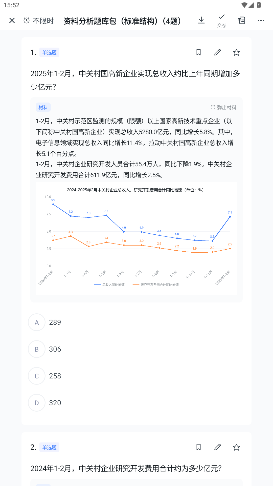

# 03 试卷包（zip）

材料里写绝对路径，换台设备就丢图。**试卷包**把试卷 Excel 和媒体资源（图片等）打成一个 zip，
导入时自动解压到应用私有目录，材料里的相对路径会在入库前换成解压后的绝对路径——之后翻题不必再算包内位置。

---

## 标准目录结构

```
资料分析试卷包.zip
└── 资料分析试卷包/            ← 外层目录可有可无（有它就当试卷名）
    ├── 试卷.xlsx              ← 必需：试卷主数据（统一 Excel 模板）
    ├── images/                ← 媒体资源
    │   ├── chart-01.png
    │   └── chart-02.png
    └── README.txt             ← 可选：说明文件，不参与导入
```

主数据就是普通的 Excel 试卷（写法见 [02 试卷格式规范](02-试卷格式规范.md)），
材料 / 图片列里的图写**包内相对路径**：

| 列 | 写法 |
|---|---|
| 图片 | `images/chart-01.png`（多张用 `\|` 分隔） |
| 材料 | 正文里写 `` |

---

## 规则

| 项 | 规则 |
|---|---|
| 主数据文件 | **只认 xlsx**：包根目录（或一层子目录）下所有 `.xlsx` 都当候选，逐个试解析，取「真正能导入题数最多」的那份；命名 `试卷.xlsx` / `qbank.xlsx` 的优先。导入前的提示会说明选用了哪份、其余各能出多少题 |
| 外层目录 | 压缩软件默认「再包一层文件夹」不影响，单层自动剥掉；**试卷名取这层目录名**，没有外层目录就沿用 zip 文件名（导入页可改） |
| 图片引用 | `images/x.png`、`./images/x.png`，或只写文件名 `x.png`；匹配时忽略大小写，`%E5%9B%BE.png` 这类百分号转义会先还原。导入时一律替换成解压后的绝对路径再入库 |
| 默认试卷名 | 外层目录名（见上），或 zip 文件名；包内那份 Excel 有多张工作表时，每张表各成一份卷，卷名取 sheet 名（见 [02 试卷格式规范](02-试卷格式规范.md#一份-excel-放多份试卷)） |
| 重复题 | 题干、材料、选项完全一致（忽略空白差异）的题只保留第一次出现的，预览页会显示「重复跳过 N」；去重按卷内做 |
| 解压位置 | `filesDir/qbank_pkg/<包名>-<CRC32>/`；同一个包重导入复用同一目录，内容变了换新目录，不会新旧图混用 |
| 路径安全 | `..`、绝对路径、`__MACOSX/` 这类条目直接跳过，绝不会写到包外 |
| 体积上限 | 单个素材 32 MB，试卷 Excel 单份 16 MB，解压总量 256 MB |
| 嵌套 | 包内不能再放 zip；答案 / 解析文件也不支持 zip |

几个容易出错的地方：

* **包里别放多份打架的 Excel**：程序会挑能出题最多的那份，但看到导入提示里的 WARN 就该整理包内容。
* **试卷 Excel 别放深层目录**：候选只认包根目录和一层子目录（`depth <= 1`）。
* **图片文件名带空格也行**：`images/my chart.png` 和 `images/my%20chart.png` 都能还原，但仍建议用 `chart-01.png` 这类名字。
* **图片只做本地解码**，不申请网络权限，包内图不要写 http 地址。

---

## 打包

整个文件夹压成 zip 即可，不需要特定工具：

```bash
# macOS / Linux
zip -r 资料分析试卷包.zip 资料分析试卷包

# Windows（PowerShell）
Compress-Archive -Path .\资料分析试卷包\* -DestinationPath .\资料分析试卷包.zip
```

仓库自带示例，可以直接导入体验：

* `sample/资料分析试卷包/`（目录形态）
* `sample/资料分析试卷包.zip` / `templates/试卷包模板.zip`（打包结果，由 `node tools/make_samples.js` / `node templates/make_templates.js` 生成）

导入页「载入示例 → 资料分析试卷包（Excel + 图片）」即用前者。
想从零开始，用 [templates/试卷包模板.zip](../templates/试卷包模板.zip)：结构照抄即可。


导入后同一份材料下的题可以进左右分屏页作答：



---

## 什么时候不用试卷包

| 情况 | 建议 |
|---|---|
| 材料里没有图，或图是 `:::chart` 自绘的 | 单个 `.xlsx` 就够，好维护 |
| 图很少、只在自己手机上用 | 直接把图放 `/sdcard/Download/` 下写绝对路径，或用 base64 塞进「图片」列 |
| 要发给别人 / 换设备 | 用试卷包，否则对方的图一定丢 |
