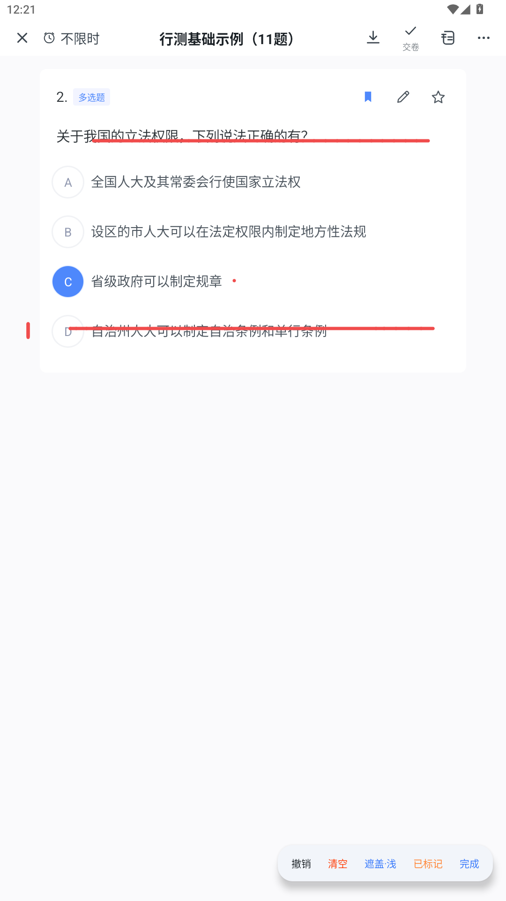

# 05 界面与交互

界面遵循刷题类应用的通行范式，全部为独立实现，不含任何第三方应用的代码与资源。
色板与尺寸以 `res/values/colors.xml`、`dimens.xml` 里的 `fb_*` 令牌集中管理，改主题只需改这两处。

---

## 全站统一版式

答题页的配色与尺寸量化校准过，这一套沉淀成全站共用的版式令牌，其余页面全部对齐：

| 项 | 统一值 | 令牌 |
|---|---|---|
| 页面底色 | `#F9FAFC` | `fb_page_bg` |
| 卡片 | 白底 8dp 圆角，页面左右 16dp、卡间距 12dp、卡内 16dp | `bg_fb_card` / `fb_page_pad` / `fb_card_gap_v` / `fb_card_pad` |
| 顶栏 | 白底 44dp + 状态栏高度，28dp 细线图标，标题 17sp 加粗居中 | `FbTitleBar` |
| Tab 页标题 | 左对齐 20sp 加粗 | `usePageTitleStyle()` |
| 主按钮 | 46dp 高 / 23dp 胶囊 / 主蓝白字 | `FbPrimaryButton` |
| 次按钮 | 同尺寸，浅蓝底 `#F1F3FF` + 主蓝字 | `FbGhostButton` |
| 字号层级 | 20 / 17 / 15 / 14 / 13 / 12 | `fb_text_*` |
| 底部导航 | 白底 54dp，图标 22dp / 文字 10sp，未选 `#8A9095`、选中主蓝 | `itemIconTint=@color/nav_item_tint` |

`FbTitleBar`（统一标题栏，自动并入状态栏 inset）与 `UiInsets.applyNavBarBottomPadding()`
（解决 Android 15 强制 edge-to-edge 后底部按钮被手势条压住）是新页面直接复用的两个组件，
连同 `FbSwitchView` / `FbDialog` 构成共用件。

---

## 答题页

* 顶栏 44dp：`X` 关闭 / 闹钟 + 倒计时胶囊 / 居中标题「试卷名（题数）」/ 右侧导出·交卷·答题卡·更多
* 题目卡：浅蓝题型标签，圆形 A/B/C/D 选项徽标（选中变蓝色实心圆），右上角标记 / 收藏 / 笔
* **没有底部操作条**：上一题 / 下一题交给滚动与左右滑动，跳题用答题卡

### 单题 / 多题切换

`更多 → 多题浏览 / 单题浏览`：

| 模式 | 容器 | 行为 |
|---|---|---|
| 多题浏览 | `QuestionListAdapter` + 连续滚动列表 | 一屏多题，上下滚动 |
| 单题浏览 | `QuestionPagerAdapter` + `ViewPager2` | 一屏一题，左右滑动切题；长题干与材料题可在页内纵向滚动 |

两套容器共享同一份题目卡渲染（`QuestionCardBinder`），切换时按「当前正在看的题」双向定位，
答案、标记、收藏、字号、交卷后的解析全部同步；选择会持久化，下次进入沿用。

### 计时与交卷

倒计时、剩 5 分钟提醒、超时自动交卷；交卷二次确认（「你还有 N 道题目未作答，确定交卷吗？」）。

---

## 夜间模式

`更多 → 夜间`。这是「答题流程内」的局部换色，**不走系统 `DayNight`**（原因见下），所以每一层都显式换色：

| 范围 | 覆盖内容 |
|---|---|
| 答题页 | 页面底 / 顶栏 / 顶栏 5 个图标 / 题号 / 题型标签 / 标记·笔记·收藏 / 题干 / 选项文字与圆形徽标 / 材料区与表格 / 笔记·解析 |
| 更多面板 | 面板底 / 分段控件轨道与选中胶囊 / 字号档位文字 / 自动下一题与手写标注的开关轨道 |
| 遮盖层工具条 | 悬浮胶囊底与按钮文字；遮盖纸由白纸换深色纸（`InkOverlay.night`） |
| 答题卡弹层 | 弹层底 / 标题行 / 分组标题 / 未答题号 |
| 系统栏 | 状态栏与导航栏的底色、图标明暗 |

夜间色板集中在 `colors.xml` 的 `fb_night_*`，圆角、字号、间距一律复用日间令牌，切换时版式零位移。
偏好持久化，重进直接生效。

> 已知边界：资料分析左右分屏页（`SplitExamActivity`）目前仍是日间配色，尚未接入夜间。

---

## 题目遮盖层（写画模式）

做纸质卷子的手感：想写就写，但不想在写字时把选项点掉、把题翻过去。
所以**不是**加一层透明浮层，而是给题目盖一张可写的薄纸——`InkOverlay` 既是画布，也是触摸拦截层。

入口是题目卡右上角那支笔：**点 = 给这一题盖纸上写**（题目会自动顶到内容区最上面，因为笔迹是屏幕坐标，
卡片对齐了圈画才落在题面上）；**长按 = 文字笔记**。

写画模式下屏幕右侧有一条细轨道（横屏可见），按住上下拖就能滚题目，笔迹跟着文字走：

| 项 | 行为 | 实现 |
|---|---|---|
| 入口 | 题目卡右上角「笔」（点=写画，长按=笔记）；`更多 → 手写标注·遮盖`；分屏页底部「手写标注」 | `QuestionCardBinder` + `InkToolbarController`，开关与工具条共享同一份状态 |
| 遮盖 | 四档：关 / 浅 / 中 / 深（alpha 0 / 24 / 58 / 110）；日间铺白、夜间铺黑 | `InkOverlay.Shade`，档位存 `ink_prefs`，跨题跨页面记住 |
| 输入 | 手指、触控笔都能写；按笔迹跟踪单个触点，掌托 / 第二指不打断 | `activePointerId` + `findPointerIndex` |
| 拦截 | 写画模式下吞掉全部触摸，不透传选项、不许翻页 | `onTouchEvent` 全 `return true` |
| 滚动 | 贴屏幕最右边一条上下拖，滚当前题目容器，那里不落笔；分屏页左边缘也有同样一条滚材料 | `scrollTargetResolver` + `barTouchWidth` |
| 竖屏 | 不画手柄（屏幕窄），热区收窄到 16dp 贴边 | `railVisible = false` |
| 退出 | 点「完成」只退出写画：**笔迹留着**、触摸恢复 | `writeMode = false` → `isEnabled = false` |
| 持久化 | 笔迹按题存 `inks` 表，切题 / 滚动 / 翻页时重新绑定当前题 | `bindQuestion()` |
| 标记 | 工具条「标记」与题目卡书签、答题卡是同一份 `marked` 数据 | `InkToolbarController.setMarked` |

### 四个容易踩的点

1. **不能只是 `GONE`** —— 早期实现「完成」就把整层隐藏，笔迹跟着消失；现在常驻可见，只切拦截开关；
2. **不能只认 `TOOL_TYPE_STYLUS`** —— 没笔的人永远写不出来；两种输入都收，靠「写画模式」这个显式开关区分；
3. **不能按 `pointerCount` 判多指** —— 用笔时掌托一落就断笔；改成锁定落笔那一根指针；
4. **卡片上的笔必须真的接进写画** —— 早先这支笔绑的是「编辑笔记」弹窗，点了当然看不到画布。

### 滚动通道的两个坑

1. **`RecyclerView.computeVerticalScrollOffset()` 不能用来量位移** —— 那是给系统滚动条用的估算值（按平均项高折算），
   乘出来的笔迹会越滚越偏。改成直接读容器自己的真实偏移：`ScrollView` / `NestedScrollView` 看 `scrollY`，
   `RecyclerView` 看首个可见项 `top` 的变化；
2. **切换浏览模式后要让遮罩层重画一次** —— 容器刚从 `GONE` 转 `VISIBLE` 时还没排版，`canScrollVertically` 返回 false，
   轨道这一帧就不画；不补一次 `invalidate()` 会停在旧画面。

> 已知边界：滚动只走最右边那条窄带，正文区域仍是纯画布；笔迹按题存的是屏幕坐标，
> 同题内滚动会跟着平移，跨题滚动换绑后不会重新对齐；单题浏览下当前页不满一屏时边缘拖不动，先点「完成」再换题。

---

## 资料分析左右分屏

`更多 → 开启左右分屏`（仅本卷含材料题时出现）进入 `SplitExamActivity`：

* 左侧材料：约 40% 宽，Markdown 表格按栏宽自适应（列多时自动缩字号，不横向裁切）
* 右侧：该材料对应的全部题目连续排布，题号按整卷序号
* 两栏都能用遮盖层做标注；左边缘有专门的滚动轨道

---

## 材料渲染

| 能力 | 说明 |
|---|---|
| Markdown 表格 | 渲染成真表格，列宽按内容自适应、不横向裁切，夜间换色 |
| 配图 | 本地路径 / `file://` / `content://` / `asset://` / base64；按材料宽度铺满，最高 420dp；点一下整屏预览 |
| 自绘图表 | `:::chart` 折线 / 柱状，日夜两套配色 |
| 材料位置 | 材料块在题目卡顶部通栏展示（白底、无内嵌灰卡），随卷面滚动；同一材料组只在首题渲染一次 |
| 弹出材料 | 材料块右上角「弹出材料」：材料组进左右分屏，单题材料进独立页，`A-` / `A+` 调字号，关掉后题目位置、作答、笔迹都不动 |

图片加载失败会明确写出是哪张图没取到；只做本地解码，不申请网络权限。

---

## 其他页面

| 页面 | 内容 |
|---|---|
| 题库 | 题库列表（题库名 / 题量 / 标签），长按管理 |
| 试卷 | 一导入即一份试卷；右上角「导入」；长按可补答案 / 删除 |
| 记录 | 历次作答，点进去回看同一份成绩报告 |
| 设置 | 判题规则（多选少选给分、不定项 50%、填空部分分、主观关键词）、默认答题偏好 |

顺带修掉过的几个问题，供新页面自查：

1. `DayNight` 主题在系统深色模式下会让 Spinner 等系统控件变成「白底白字」→ 改为 `Light` 主题；
2. 导入预览的题型标签 `textColor=primary` + 蓝底 → 蓝底蓝字不可见；
3. 试卷列表题量恒为 `0`（`listPapers` 只查了 count 没回填）；
4. 练习记录点击无响应（`RecordAdapter.onClick` 从未注册）；
5. 「更多 → 开启左右分屏」入口在答题页重构时丢失 → 重新接回；
6. 分屏页顶栏仍约束到已删除的 `@id/topBar`，导致顶栏高度不计入布局、材料被状态栏压住。
